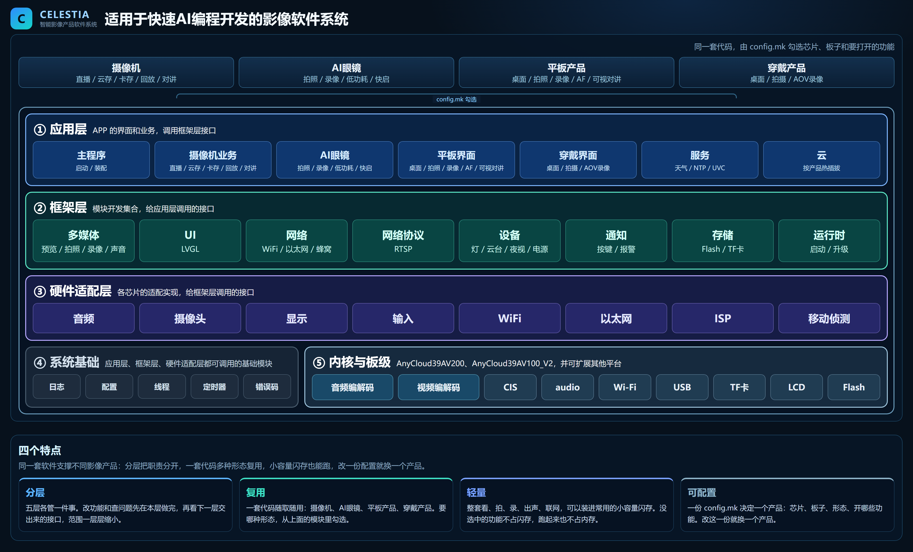

<p align="right"><a href="README.en.md">English</a> | <b>中文</b></p>

<div align="center">

# Celestia

**面向安凯微（Anyka）智能视觉 SoC 的应用软件平台**

[快速开始](#5-快速开始) · [架构总览](architecture/overview.md) ·
[产品形态](architecture/form-factor.md) · [术语与命名对照表](glossary.md)

`Apache-2.0` · 文档 `CC BY 4.0` · 嵌入式 C / C++ · 支持 Linux 与 AOS RTOS

</div>

---

## 1. 应用软件平台定位

Celestia 是跑在**安凯微（Anyka）智能视觉 SoC 的厂商 SDK** 之上的**应用软件平台**：用固定的五层结构
与单一配置入口，把"应用 / 框架 / 硬件适配 / 系统基础 / 内核与板级"分开，为摄像机、AI 眼镜、
平板、穿戴四类影像产品提供统一的软件底座。上层源码与芯片、与产品形态解耦 ——
**换芯片只换适配层，换形态只换一份配置**。

| 维度 | 结论 |
|:-----|:-----|
| **软件性质** | 应用框架 + 硬件适配层 + 基础库的源码集合，编译为一个主程序 + 若干业务 SO |
| **依赖的下层** | 安凯微 SDK：`AnyCloud39AV200`（RISC-V / Linux）、`AnyCloud39AV100_V2`（ARM / Linux）、`Sky39AV130`（ARM / AOS RTOS） |
| **产品差异的唯一合法来源** | `project/<product>/config.mk` → 生成 `config.h`；运行期再叠加 `settings.json` |
| **运行形态** | 单进程 + 多线程；业务模块以 `.so` 动态加载（AOS 下改为静态链入） |
| **交付物** | 每产品一个主可执行文件 + 若干业务 SO + rootfs / 内核 / 烧录镜像（`out/<product>/`） |
| **厂商专有部分**（另行获取） | 厂商 SoC 库、`libak_nne` / `libak_nna` / `libmpi_svp` 等二进制、模型 / 字库 / 烧录工具（厂商专有，不受 Apache-2.0 覆盖） |

> 术语（`AOS` / `IOTCamera` / `AI_GLASSES` / `TABLET` / `WEARABLE` / EVB / PDK 等）以
> [术语与命名对照表](glossary.md) 为唯一解释源；产品形态的判据与选型见
> [产品形态](architecture/form-factor.md)。

---

## 2. 设计要点

| 要点 | 做法 | 作用 |
|:-----|:-----|:-----|
| **分层** | 五层固定，跨层只走对方 `include/` 公开头 | 故障按层收敛，定位不跨层扩散 |
| **单一配置入口** | 产品差异只写在 `project/<product>/config.mk` | 新增产品不改源码，改一份配置 |
| **按需裁剪** | 未选中的功能不编译、不链接 | 16MB NOR 的低配机型也能装下 |
| **契约调用** | 上层经 `app_main_get_*()` + `*_open()` 取句柄 | 换 SoC 不用改业务代码 |

---

## 3. 架构



> 上图为五层架构与配置入口。分层契约、运行期模型、启动链路与构建产物见
> **[架构总览](architecture/overview.md)**。

| 层 | 目录 | 一句话职责 | 对外契约 |
|:---|:-----|:-----------|:---------|
| ① 应用层 | `application/` | 主程序装配、界面与业务、云接入 | `app_main_get_*()` + `*_open()` |
| ② 框架层 | `framework/` | 多媒体 / 网络 / 设备 / 通知 / 存储 / 运行时 / 协议 | `framework/**/include/*.h` |
| ③ 硬件适配层 | `hardware/` | 按 SoC 实现外设与媒体能力，向上统一 ops | `hardware/include/*.h` |
| ④ 系统基础 | `system/core/` | 日志 / 配置 / 线程 / 定时器 / 错误码 / 内存 / 加密 | `system/core/include/*.h` |
| ⑤ 内核与板级 | `system/<SoC>/<SDK>/`、`project/*/system/` | 厂商 SDK + U-Boot/OpenSBI + Kernel + DTS + rootfs | 设备节点、ioctl、sysfs |

**依赖方向**：① → ② → ③ → ⑤ 纵向分层；①②③ 横向依赖 ④。反向依赖即为设计违规。

---

## 4. 产品形态

产品形态由**编译期开关唯一确定**，不靠产品名推断。一个形态同时约束
**显示屏、应用包、主循环归属、保活责任** 四件事。

| 形态 | 显示屏 / 分辨率 | 编译期判据 | 主循环 | 保活责任 |
|:-----|:----------------|:-----------|:-------|:---------|
| `IOTCamera` | 无显示屏 | `PACKAGES_IPCAMERA=y` + `LCD=n` | **无** | **业务 SO 的 `module_start()`** |
| `AI_GLASSES`（移植中） | 无显示屏 | `PACKAGES_AIGLASS=y` + `LCD=n` | 无 | 快启录像、快启照相 |
| `TABLET` | 带显示屏，平板级 / 800×480 ～ 1024×600 | `PACKAGES_TABLET=y` + `LCD=y` | `tablet_run()` | GUI 框架 |
| `WEARABLE` | 带显示屏，穿戴级小屏 / ≤ 320×320（当前 240×240） | `PACKAGES_WEARABLE=y` + `LCD=y` | `app_gui_run()` | GUI 框架 |

> 摄像头不列入本表：所有形态都必备，是输入通道而不是形态判据。

**AI 眼镜形态（正在移植到本系统）**：芯片 `KM02G`，面向第一视角影像 —— **快速出图**（`FASTSYS` 快启链路）、随身采集、端侧 AI（NNE / NNA）、低功耗常驻、轻量交互。当前源码树无产品目录与 `PACKAGES_*` 开关，移植完成前不参与形态判据与选型；形态名后的「移植中」表示相关能力随移植推进确定，进展见 [产品形态](architecture/form-factor.md)。

**关于摄像头**：摄像头是**所有形态的必备输入通道**（全部 5 个产品均为 `CONFIG_HW_CAMERA=y` + `CONFIG_FW_MULTIMEDIA_CAMERA=y`），不是可选外设。
形态差别不在"有没有摄像头"，而在**画面送到哪里**：推流与存储（`IOTCamera`）、第一视角采集与端侧 AI（`AI_GLASSES`，移植中）、本地显示（`TABLET` / `WEARABLE`）。

### 产品矩阵

| 产品 | SoC / SDK | BOARD | 形态 | 显示屏 / 分辨率 | 主程序 | OS |
|:-----|:----------|:------|:----:|:----------------|:-------|:---|
| `anypi_nova` | AnyCloud39AV200 / V1.04 | `PDB_MBD_AK3918AV200_ACTCAM` | `TABLET` | 800×480 | `ipc_main` | linux |
| `anypi_nova_dev` | AnyCloud39AV200 / V1.04 | `EVB_MBD_AK3918AV200` | `TABLET`（EVB） | 1024×600 | `nova_main` | linux |
| `anypi_luna` | AnyCloud39AV100_V2 / V2.05 | `PDB_MBD_KM01W_ACTCAM` | `WEARABLE` | 240×240 | `luna_main` | linux |
| `anypi_luna_dev` | AnyCloud39AV100_V2 / V2.04 | `EVB_MBD_KM01A` | `IOTCamera` | 无显示屏 | `luna_dev_main` | linux |
| `anypi_mira_dev` | Sky39AV130 / V1.01 | `EVB_CBD_AK3918AV130` | `IOTCamera` | 无显示屏 | `mira_main` | **aos** |

> 判据矩阵、启动分岔、各形态配置清单与选型流程见
> **[产品形态](architecture/form-factor.md)**。

---

## 5. 快速开始

```bash
# 1. 获取源码（GitHub）
repo init -u https://github.com/OpenCelestia/manifest.git -b main -m default.xml
repo sync -c -j4

# 同一批提交的 Gitee 镜像：查看文档并下载
# https://gitee.com/OpenCelestia/docs/blob/main/README.md
repo init -u https://gitee.com/OpenCelestia/manifest.git -b main -m gitee.xml
repo sync -c -j4

# 2. 放置厂商 SDK（不在源码树内，需按授权渠道获取）
#    → system/<SoC>/<SDK_VERSION>/

# 3. 编译 + 打包
./build.sh --product-name anypi_nova
```

| 步骤 | 动作 | 文档 |
|:----:|:-----|:-----|
| 1 | 获取源码与工具链 | [download.md](quick-start/download.md) |
| 2 | 放置厂商 SDK | [download.md](quick-start/download.md) |
| 3 | 选择产品并编译 | [build.md](quick-start/build.md) |
| 4 | 烧录与上板验证（PASS/FAIL 清单） | [deploy.md](quick-start/deploy.md) |

**常用命令**

```bash
./build.sh                                    # 交互选择产品，并缓存到 out/.build_product_name
./build.sh --product-name anypi_nova          # 全量编译 + 打包
./build.sh -h -f -a --product-name anypi_luna # 分层重编：hardware → framework → application
./build.sh --product-name anypi_nova -c -f -a # 清理后重编 framework + application
```

**分层编译开关**：`-t` third_party · `-s` system/core · `-h` hardware · `-f` framework ·
`-a` application · `-k` kernel/BSP。
**依赖顺序**：`third_party → system/core → hardware → framework → application → package`。

---

## 6. 目录结构

```text
celestia/                        # 源码根
├── build.sh -> scripts/build.sh
├── application/                 # ① 应用层：app_main · packages · services · cloud
├── framework/                   # ② 框架层：services · gateway · runtime · ui
├── hardware/                    # ③ 硬件适配层：include(公开头) · hal/<SoC> · driver · vision
├── system/core/                 # ④ 系统基础：log · config · thread · time · memory · crypto
├── project/<product>/           # ⑤ 产品工程：config.mk · 该 SoC 的 board / patch
├── scripts/                     # 构建脚本
├── third_party/                 # 第三方组件（LVGL · FFmpeg · mbedTLS · cJSON · tslib …）
└── docs/                        # 文档（本目录）
```

逐目录职责与新文件放置决策见 **[目录地图](architecture/directory-map.md)**。

---

## 7. 文档导航

```text
docs/
├── README.md                     ← 本页：定位与入口
├── glossary.md                   ← 术语与命名对照表（AOS / TABLET / EVB …）+ 标识符命名规范（§11）
├── CONTRIBUTING.md               ← 贡献流程与提交规范
├── architecture/
│   ├── overview.md               ← 分层 · 契约 · 运行期 · 配置 · 启动 · 构建
│   ├── form-factor.md            ← 产品形态：判据 · 分岔 · 选型
│   ├── directory-map.md          ← 目录职责与新文件放置
│   └── images/overview.png
├── quick-start/                  ← download · build · deploy · bsp-and-products · roles
└── guide/                        ← 分层概念与 API + DevStudio
    ├── README.md                 ← Guide 索引
    ├── application.md            ← 应用层
    ├── framework.md / *-api.md   ← 框架与 API
    ├── hardware-hal.md / *-api.md← HAL 与 API
    ├── system-core.md / *-api.md ← system/core 与 API
    ├── api-index.md / conventions.md
    └── devstudio.md               ← DevStudio CLI / MCP / Skill / 推板
```

| 我想… | 读这个 |
|:------|:-------|
| 搞清楚某个缩写是什么意思 | [glossary.md](glossary.md) |
| 知道目录 / 宏 / 文件该怎么命名 | [glossary.md §11](glossary.md#11-标识符命名规范) |
| 理解整体架构与分层边界 | [architecture/overview.md](architecture/overview.md) |
| 判断产品该用哪个形态 | [architecture/form-factor.md](architecture/form-factor.md) |
| 知道某段代码该放哪个目录 | [architecture/directory-map.md](architecture/directory-map.md) |
| 把代码跑起来 | [download.md](quick-start/download.md) → [build.md](quick-start/build.md) → [deploy.md](quick-start/deploy.md) |
| 加一块新板 / 一颗新 SoC | [bsp-and-products.md](quick-start/bsp-and-products.md) |
| 查 API | [api-index.md](guide/api-index.md) |
| 确认文档与代码的约定 | [conventions.md](guide/conventions.md) |
| 查分层 Guide | [guide/README.md](guide/README.md) |
| 安装 / 使用 DevStudio（CLI / MCP / 推板） | [devstudio.md](guide/devstudio.md) |
| 用 AI 按场景干活 | [roles.md](quick-start/roles.md) → 工程根 `AGENTS.md` 命中的 Skill |
| 排查上板 / 推应用 | [devstudio.md](guide/devstudio.md) §7 · celestia-debug / celestia-studio Skill |

### 7.1 按场景进入

直接说目标 → AI 按 [roles.md](quick-start/roles.md) 用 Ask 补齐缺项 → 读 `AGENTS.md` 命中的 Skill 落地。

| 场景 | 关注点 | 入口 |
|:-----|:-------|:-----|
| 新产品 / 新板 | BOARD + 形态；`IOTCamera` 走 `packages/ipcamera` SO | [roles §2](quick-start/roles.md#2-新产品--新板) |
| 应用 | 仿现有 App，只走 Framework 公开接口 | [roles §3](quick-start/roles.md#3-应用) |
| 新芯片 | HAL + board overlay，公开头不改 | [roles §4](quick-start/roles.md#4-新芯片) |
| 调试 | 贴 log → Bug A–G → 闭环 | [roles §5](quick-start/roles.md#5-调试) |

---

## 8. Skills（AI 可执行知识）

Skill 正文在 `devstudio/celestia/`、`devstudio/sdk/`，由工程根 **`AGENTS.md`** 按场景引用（`./build.sh` / `devstudio init` 生成）。
**不要**复制到 `.cursor` / `.claude` / `.vscode`。用法见 [guide/devstudio.md](guide/devstudio.md)；MCP 定义在 `devstudio/ide/`。

---

## 9. 许可与第三方

- 分级（A 源码 Apache-2.0、B 第三方、C `project/` 预编译件随库分发但不适用 Apache-2.0、D 芯片 SDK 与云端闭源库不入库）和必须在控制台轮换的凭据见 [开源风险说明](open-source.md)。
- 本系统源码：**Apache-2.0**，见各目录 `LICENSE` / `NOTICE`。
- **C 级**（留在 `project/`，不受 Apache-2.0 覆盖）：`patch/platform/lib/` 下的 `libak_nne` / `libak_nna` / `libmpi_svp` 等，以及模型、字库、烧录镜像。
- **D 级**（不在本树）：各产品 `system/AnyCloud39AV*`、`Sky39AV130` 芯片 SDK，以及 `application/cloud` 里的闭源库。
- 第三方组件清单与版本：`third_party/THIRD_PARTY_NOTICES.md`；本项目用到的组件见
  [glossary §9](glossary.md#9-第三方组件third_party)。

---

<div align="center">

[回到顶部](#celestia) · [架构总览](architecture/overview.md) ·
[产品形态](architecture/form-factor.md) · [术语对照表](glossary.md) ·
[约定](guide/conventions.md) · [DevStudio](guide/devstudio.md)

</div>
