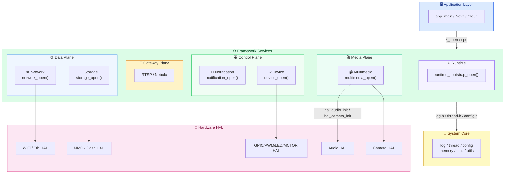
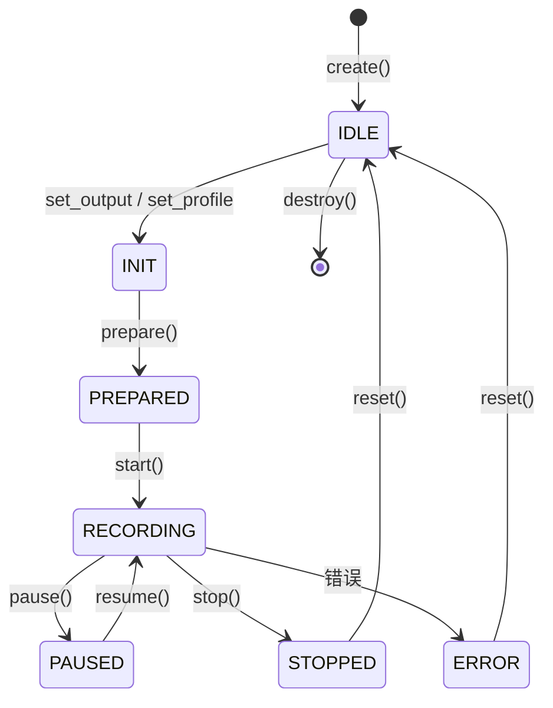
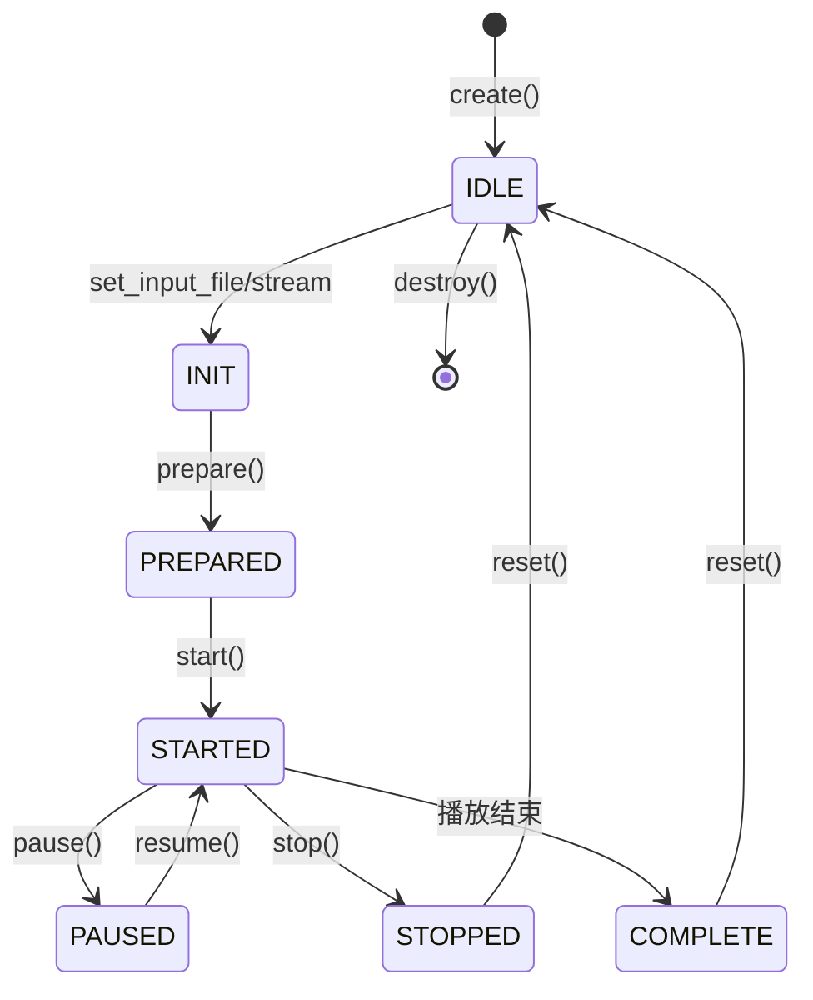
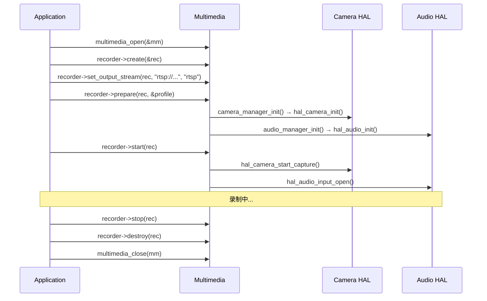
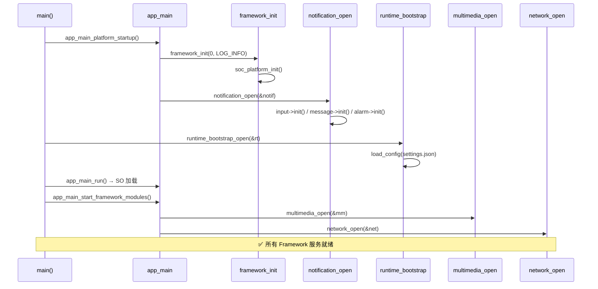
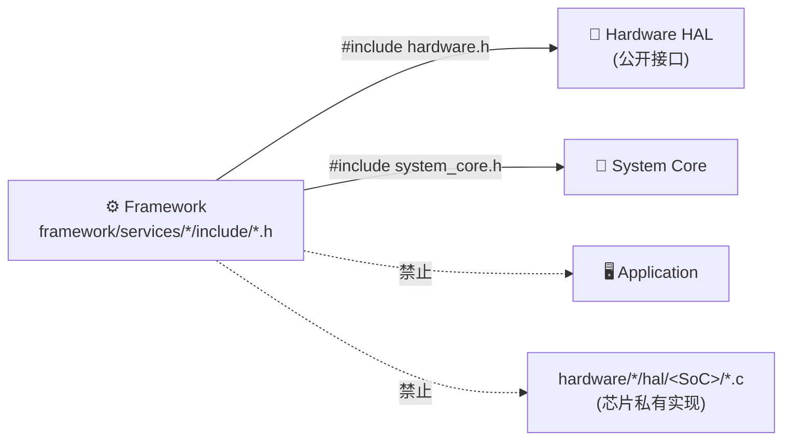
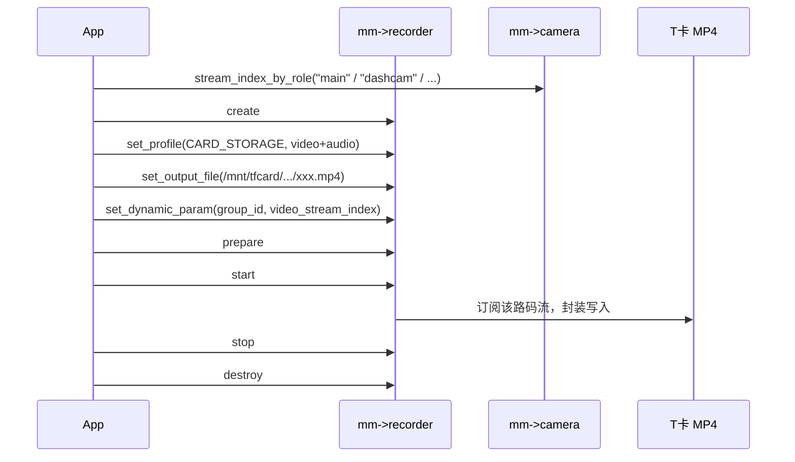

# Framework Services

> **本文范围**：Framework 服务层：服务清单与职责、统一生命周期（`*_open()` → ops → `*_close()`）、各服务的典型调用流程与依赖边界。
>
> 逐函数签名见 [framework-api.md](framework-api.md)；下行 HAL 契约见 [hardware-hal.md](hardware-hal.md)。

---

## 1. 服务总览



ASCII 备用：

```
┌─ 🖥️ Application (app_main / Nova / Cloud) ─────────────────────┐
└──────────┬───────────────────────────────────────────────────────┘
           │ *_open / ops
┌──────────▼───────────────────────────────────────────────────────┐
│  ⚙️ Framework Services                                            │
│  ┌───────────────┐ ┌────────────┐ ┌───────────┐ ┌──────────────┐ │
│  │ 🎬 Media       │ │ 🎛️ Control  │ │ 🌐 Data    │ │ 🔗 Gateway    │ │
│  │ Multimedia    │ │ Notification│ │ Network   │ │ RTSP / Nebula│ │
│  │               │ │ Device      │ │ Storage   │ │              │ │
│  └───────────────┘ └────────────┘ └───────────┘ └──────────────┘ │
│  ⚙️ Runtime (bootstrap / console / ota / security)                │
└──────────┬─────────────────────────────┬─────────────────────────┘
           │ log/thread/config           │ hal_*_init / hw_module_t
           ▼                             ▼
  🔧 System Core                     🔌 Hardware HAL
```

### 1.1 服务矩阵（Application ↔ Framework ↔ HAL）

| Framework 服务 | 公开头文件 | 关键 HAL / 外设 | 典型 App 使用场景 |
|---|---|---|---|
| 📹 **Multimedia** | `multimedia.h` | Audio / Camera / Display / OSD / GPU | 录像、直播推流、拍照、语音通话 |
| 🌐 **Network** | `network.h` | WiFi / Ethernet | 配网、NTP、Ping、RTSP 推流 |
| 🔔 **Notification** | `notification.h` | Input / IR | 按键事件、告警、消息队列 |
| 💡 **Device** | `device.h` | GPIO / LED / PWM / Motor / Backlight | PTZ、夜视、背光、电源管理 |
| 💾 **Storage** | `storage.h` | MMC / eFlash | TF 卡、Flash 键值、文件录像 |
| 🔗 **Gateway** | `nebula_protocol.h` / RTSP | Network | 云平台协议、RTSP 流媒体服务 |
| ⚙️ **Runtime** | `runtime.h` | —（跨 Framework）| 配置加载、命令行控制台、OTA |

### 1.2 统一生命周期模式


所有 Framework 服务遵循相同模式：`*_open()` 获取句柄 → 通过 ops 结构调用功能 → `*_close()` 释放资源。

---

## 2. Multimedia 服务

**头文件**：`framework/services/multimedia/include/multimedia.h`
**版本**：`MULTIMEDIA_VERSION` = 1.0.0（`MULTIMEDIA_VERSION_MAJOR = 1`）

### 2.1 服务结构

```c
typedef struct {
    recorder_ops_t *recorder;   /* 媒体录制 */
    player_ops_t   *player;     /* 媒体播放 */
    camera_ops_t   *camera;     /* 摄像头直接访问 */
    audio_ops_t    *audio;      /* 音频直接访问 */
    osd_ops_t      *osd;        /* OSD 字幕叠加 */
    void *reserved[8];
} multimedia_t;
```

### 2.2 全局 API

| 函数签名 | 说明 | 返回值 |
|---|---|---|
| `int multimedia_open(multimedia_t **out)` | 打开多媒体服务，获取句柄 | 0 成功；负数错误码 |
| `int multimedia_close(multimedia_t *multimedia)` | 关闭服务，释放所有资源 | 0 成功 |

> `multimedia_open()` 不会立即初始化 HAL；摄像头 HAL 在第一次 `stream_reg_client()` 或 `prepare()` 时懒初始化。

### 2.3 Recorder API（`multimedia->recorder`）

> 主/子码流落 T 卡的调用顺序、限制与改 framework 边界见文末「主码流 / 子码流 H.264·H.265 录像落 T 卡（专题）」。



| 函数 | 说明 |
|---|---|
| `create(handle*)` | 创建录制实例 → IDLE 状态 |
| `destroy(handle)` | 销毁实例（必须先 stop）|
| `reset(handle)` | 重置到 IDLE 状态 |
| `set_profile(handle, profile*)` | 设置 Profile（output_flags + module_flags）|
| `prepare(handle, profile*)` | 同步准备资源（绑定 HAL 能力）|
| `prepare_async(handle, profile*)` | 异步准备，完成后触发 `MEDIA_RECORDER_EVENT_PREPARED` |
| `start(handle)` | 开始录制 |
| `stop(handle)` | 停止录制 |
| `pause(handle)` | 暂停 |
| `resume(handle)` | 恢复 |
| `set_output_file(handle, path)` | 设置输出文件路径或目录（目录时自动按日期命名）|
| `set_output_stream(handle, url, protocol)` | 设置推流 URL（RTSP/RTMP）|
| `set_stream_callback(handle, type, cb, userdata)` | 注册原始流回调 |
| `get_video_enc_param(handle, param*)` | 获取当前视频编码参数 |
| `get_audio_enc_param(handle, param*)` | 获取当前音频编码参数 |
| `set_volume(handle, vol)` | 设置录音输入音量 |
| `set_dynamic_param(handle, param*)` | 动态调整码率/帧率/GOP |
| `set_max_duration(handle, ms)` | 限制最大录制时长 |
| `set_max_file_size(handle, bytes)` | 限制最大文件大小 |
| `get_state(handle, state*)` | 查询当前状态 |
| `is_recording(handle, flag*)` | 是否录制中 |
| `set_event_callback(handle, cb, userdata)` | 注册事件回调 |

**Profile 配置（`media_recorder_profile_t`）：**

| 字段 | 类型 | 说明 |
|---|---|---|
| `output_flags` | `media_output_flags_t` | 组合：`CLOUD/LIVE_STREAM/CARD_STORAGE/PREVIEW/TALK/SPEAKER` |
| `module_flags.enable_video` | int | 是否启用视频 |
| `module_flags.enable_audio` | int | 是否启用音频 |
| `module_flags.enable_osd` | int | 是否启用 OSD |
| `module_flags.enable_ai` | int | 是否启用 AI |

**录制事件（`media_recorder_event_t`）：**
`PREPARED / STARTED / STOPPED / PAUSED / RESUMED / ERROR / INFO / MAX_DURATION_REACHED / MAX_FILE_SIZE_REACHED`

### 2.4 Player API（`multimedia->player`）



| 函数 | 说明 |
|---|---|
| `create(handle*)` | 创建播放器 |
| `destroy(handle)` | 销毁 |
| `reset(handle)` | 重置到 IDLE |
| `set_input_file(handle, path)` | 设置本地文件 |
| `set_input_stream(handle, url, protocol)` | 设置网络流 |
| `set_realtime_source(handle, cam_id, channel, audio_src)` | 实时摄像头源 |
| `prepare(handle)` | 同步准备 |
| `prepare_async(handle)` | 异步准备 |
| `start(handle)` | 播放 |
| `stop(handle)` | 停止 |
| `pause(handle)` / `resume(handle)` | 暂停/继续 |
| `seek(handle, pos_ms)` | Seek 到指定位置（ms）|
| `get_position(handle, pos_ms*)` | 获取当前播放位置 |
| `get_duration(handle, dur_ms*)` | 获取总时长 |
| `set_volume(handle, vol)` | 播放音量（0-100）|
| `set_mute(handle, mute)` | 静音 |
| `set_playback_speed(handle, speed)` | 倍速播放（0.5x-4.0x）|
| `set_window(handle, win)` | 设置显示窗口句柄 |
| `set_video_scaling_mode(handle, mode)` | 缩放模式：SCALE_TO_FIT / SCALE_WITH_CROPPING |
| `set_video_show_callback(handle, cb, user)` | 注册视频帧回调（用于自绘）|
| `get_state(handle, state*)` | 查询状态 |
| `is_playing(handle, flag*)` | 是否播放中 |
| `set_event_callback(handle, cb, userdata)` | 注册事件回调 |

### 2.5 Camera API（`multimedia->camera`）

> 提供直接访问摄像头码流的能力（用于订阅视频帧、AI 分析等）。

| 函数 | 说明 |
|---|---|
| `stream_get_configs(streams**, num*)` | 获取所有码流配置（来自 `fw_video_config.json`）|
| `stream_get_id(cam_id, channel)` | 按摄像头 ID + 通道获取 stream index |
| `stream_index_by_name(name, out*)` | 按码流名称查找 index |
| `stream_index_by_role(role, out*)` | 按角色（main/preview/ai/qr）查找 index |
| `stream_get_channel_size(stream, w*, h*)` | 获取码流分辨率 |
| `stream_enable(stream, enable)` | 启用/禁用码流 |
| `stream_reg_client(stream, handle*, cb, user)` | 注册码流订阅客户端（触发 HAL 懒初始化）|
| `stream_unreg_client(handle)` | 注销客户端 |
| `stream_get_frame(handle, frame*)` | 同步获取帧 |
| `stream_force_i_frame(stream)` | 强制插入 I 帧 |
| `stream_set_enc_param(stream, param*)` | 动态修改编码参数 |
| `capture_picture(stream, param*, data**, size*)` | 抓图（JPEG/PNG）|
| `set_effect(cam, type, value)` | 画面效果（亮度/对比度/饱和度等）|
| `set_ai_enabled(enable)` | 全局启用/禁用 AI |
| `set_ai_scene(scene_id)` | 切换 AI 场景 |
| `ai_get_config(out*, count*)` | 获取 AI 配置 |
| `load_config(video_cfg, ai_cfg)` | 重新加载视频/AI 配置 |

**AI 目标类型（`media_ai_target_type_t`）：**
`HUMAN_SHAPE / HUMAN_FACE / PET / VEHICLE / NON_MOTOR_VEHICLE / HUMAN_HAND / PACKAGE / CRY / HUMAN_UPPER / FACE_RECO / MOTION`

#### 2.5.1 `fw_video_config.json` —— 能力集 + 每应用分离

`fw_video_config.json` 描述的是**板级视频能力集**（capability set）：本板可提供哪些摄像头通道
（`channels[]`：分辨率/`max_buffers`/`crop`/`num_slices` 等）、哪些码流角色（`streams[]`：
`main/preview/ai/qr/...` 的编码、码率、`cirbuf_size`）。它由 framework 的
`config_loader.c` 加载，是 `stream_get_configs()` / `stream_index_by_role()` 的数据源。

**设计原则：每个应用各自声明用量，互不共用一份配置。** 一个应用的录像/抓图/预览布局不应
塞进另一应用的配置，也不应两个应用共用同一份应用级 video 配置。实现上有两种等价机制：

1. **`app_stream_usage` 段**（默认）：在 `fw_video_config.json` 内为每个 App 加一段，声明
   `roles_used`、是否开 AI、`stream_reg_client` 哪些路；新增 App 时加一段，不动 `channels/streams`
   能力集本身。nova 侧即此机制——`app_stream_usage` 为 `ipc_camera / camera_app /
   settings_lv_video_ctrl / settings_qr_scan / volc_app` 各自一段；luna 侧 `fw_video_config.json`
   的 `app_stream_usage` 为 `camera_app / settings_lv_video_ctrl` 两段。
2. **应用私有整份配置 + `load_config` 切换**：当某 App 需要完全不同的 sensor 裁剪 / 分辨率 / 编码
   （与能力集不兼容）时，给它一份独立的整份 video 配置（含自己的 `channels/streams`），App 启动时
   调 `multimedia->camera->load_config("<私有配置>", "")` 切换，退出时 `load_config(fw_video_config.json)`
   还原。luna 的 dashcam 即此机制——使用 `app_dashcam_config.json`（main 1920×1080 H.264 录像 +
   sub 1024×576 H.264 RTSP），与 camera app 的 1600×1200 H.265 能力集互不干扰。

文件位置（board rootfs overlay，**不在** `project/<product>/config/`）：
`project/<product>/system/<SoC>/<SDK>/board/<Board>/rootfs/utils/etc/config/fw_video_config.json`。
luna_dev 的 dashcam 私有配置 `app_dashcam_config.json` 同样放在板级 overlay
（`project/anypi_luna_dev/.../board/EVB_MBD_KM01A/rootfs/utils/etc/config/`），随 rootfs 直接安装到 `/etc/config/`。

### 2.6 Audio API（`multimedia->audio`）

| 函数 | 说明 |
|---|---|
| `audio_src_enum(srcs**, num*)` | 枚举所有音频源 |
| `stream_get_configs(streams**, num*)` | 获取音频码流配置 |
| `stream_reg_client(stream, handle*, cb, user)` | 订阅音频码流 |
| `stream_unreg_client(handle)` | 注销 |
| `talk_start(dev)` | 开启双向对讲（同时开输入/输出，AEC 前提）|
| `talk_stop(dev)` | 停止对讲 |
| `talk_send_data(dev, frame*)` | 发送对讲音频帧 |
| `out_set_volume(dev, vol)` | 设置硬件输出音量 |
| `play_notice(dev, path)` | 播放提示音（异步）|
| `play_notice2(dev, path, wait_ms, vol)` | 播放提示音（带等待时长和音量）|
| `set_audio_algorithm_enable(dev, alg, enable)` | 启用/禁用 VAD/AEC/NS/CRY/ASLC/EQ/SSL |
| `set_audio_algorithm_param(dev, alg, name, val, size)` | 设置算法参数 |
| `get_max_amplitude(dev, amp*)` | 获取最大音量幅值 |

> **AEC 注意**：AEC 仅在 `talk_start()` 之后可用，且需输入输出同时开启、采样率一致。

### 2.7 OSD API（`multimedia->osd`）

| 函数 | 说明 |
|---|---|
| `set_time_osd(cam, channel, enable)` | 时间戳叠加开关 |
| `set_text_osd(cam, channel, text)` | 文字叠加 |

### 2.8 错误码

| 宏 | 说明 |
|---|---|
| `MULTIMEDIA_OK` | 成功（= 0）|
| `MULTIMEDIA_ERROR_INVALID_PARAM` | 参数无效 |
| `MULTIMEDIA_ERROR_NOT_INIT` | 未初始化 |
| `MULTIMEDIA_ERROR_BUSY` | 资源占用 |
| `MULTIMEDIA_ERROR_IO` | IO 错误 |
| `MULTIMEDIA_ERROR_INVALID_STATE` | 状态错误 |
| `MULTIMEDIA_ERROR_TIMEOUT` | 超时 |
| `MULTIMEDIA_ERROR_MEMORY` | 内存不足 |

### 2.9 典型调用流程



---

## 3. Network 服务

**头文件**：`framework/services/network/include/network.h`
**版本**：`NETWORK_VERSION` = 1.0.0

### 3.1 服务结构

```c
typedef struct network_t {
    network_wifi_ops_t     *wifi;       /* WiFi */
    network_ethernet_ops_t *ethernet;   /* 以太网 */
    network_ntp_ops_t      *ntp;        /* NTP */
    network_ping_ops_t     *ping;       /* Ping */
    network_rtsp_ops_t     *rtsp;       /* RTSP 服务控制 */
    void *reserved[8];
} network_t;
```

### 3.2 全局 API

| 函数 | 说明 |
|---|---|
| `int network_open(network_t **network)` | 打开网络服务 |
| `int network_close(network_t *network)` | 关闭网络服务 |

### 3.3 WiFi API（`network->wifi`）

**WiFi 状态（`network_wifi_state_e`）：**
`DISABLED / DISABLING / ENABLED / ENABLING / UNKNOWN`

**STA 操作（`network->wifi->station`）：**

| 函数 | 说明 |
|---|---|
| `connect(config*)` | 连接 WiFi（SSID + 密码）|
| `disconnect()` | 断开 |
| `get_state()` | 获取 STA 连接状态 |
| `get_ip(ip)` | 获取 IP 地址 |
| `get_mac(mac)` | 获取 MAC 地址 |
| `scan(results*, count*)` | 扫描周边热点 |

**AP 操作（`network->wifi->ap`）：**

| 函数 | 说明 |
|---|---|
| `start(config*)` | 启动 AP 热点 |
| `stop()` | 关闭 AP |
| `get_state()` | 获取 AP 状态 |

### 3.4 Ethernet API（`network->ethernet`）

| 函数 | 说明 |
|---|---|
| `get_ip(ip)` | 获取以太网 IP |
| `get_mac(mac)` | 获取以太网 MAC |
| `get_state()` | 获取连接状态 |

### 3.5 NTP API（`network->ntp`）

| 函数 | 说明 |
|---|---|
| `init()` | 启动 NTP 客户端 |
| `deinit()` | 停止 |
| `set_server(ip)` | 设置 NTP 服务器 IP |

### 3.6 Ping API（`network->ping`）

| 函数 | 说明 |
|---|---|
| `ping_ipv4(dest, ttl, seq, timeout)` | IPv4 Ping |
| `ping_ipv6(dest, ttl, seq, timeout)` | IPv6 Ping |

### 3.7 RTSP API（`network->rtsp`）

| 函数 | 说明 |
|---|---|
| `init()` / `deinit()` | 初始化/反初始化 RTSP 服务器 |
| `start()` / `stop()` | 启动/停止 RTSP 服务 |
| `set_video_param_callback(cb)` | 注册视频参数请求回调 |
| `set_audio_param_callback(cb)` | 注册音频参数请求回调 |
| `set_dev_param_callback(cb)` | 注册设备参数请求回调 |

### 3.8 错误码（部分）

| 宏 | 说明 |
|---|---|
| `NETWORK_OK` | 成功 |
| `NETWORK_ERROR_CONNECTION_FAILED` | 连接失败 |
| `NETWORK_ERROR_DEVICE_NOT_AVAILABLE` | 设备不可用 |
| `NETWORK_ERROR_NETWORK_UNREACHABLE` | 网络不可达 |
| `NETWORK_ERROR_INTERFACE_NOT_FOUND` | 网络接口不存在 |
| `NETWORK_ERROR_TIMEOUT` | 超时 |

---

## 4. Notification 服务

**头文件**：`framework/services/notification/include/notification.h`

### 4.1 服务结构

```c
typedef struct notification_t {
    alarm_ops_t         *alarm;    /* 告警事件 */
    message_ops_t       *message;  /* 系统消息 */
    message_queue_ops_t *queue;    /* 消息队列 */
    input_ops_t         *input;    /* 输入事件 */
} notification_t;
```

### 4.2 全局 API

| 函数 | 说明 |
|---|---|
| `int notification_open(notification_t **n)` | 打开通知服务 |
| `int notification_close(notification_t *n)` | 关闭通知服务 |

### 4.3 Alarm API（`notification->alarm`）

**告警类型（`alarm_type_t`）：**

| 枚举值 | 说明 |
|---|---|
| `ALARM_TYPE_MD` | 移动侦测 |
| `ALARM_TYPE_MAN_BODY` | 人体检测 |
| `ALARM_TYPE_VOICE` | 声音检测 |
| `ALARM_TYPE_FACE` | 人脸检测 |
| `ALARM_TYPE_CRY` | 哭声检测 |
| `ALARM_TYPE_PREROLL` | 预录 |
| `ALARM_TYPE_VEHICLE_GEN/MOTOR/BIKE` | 车辆检测 |
| `ALARM_TYPE_ALERTAREA` | 警戒区域 |
| `ALARM_TYPE_TRANSGRESSION` | 越界检测 |
| `ALARM_TYPE_PET` | 宠物检测 |
| `ALARM_TYPE_PACKAGE` | 包裹检测 |
| `ALARM_TYPE_CALL_TO_SERVER_S/E` | 呼叫服务器开始/结束 |

| 函数 | 说明 |
|---|---|
| `init()` | 初始化告警管理器 |
| `uninit()` | 反初始化 |
| `post(type, data, len)` | 发布告警（AI/MD 检测结果驱动）|
| `detach(type)` | 解除某类型告警 |
| `reg_client(type, cb, user, min_interval_ms)` | 注册告警消费者（带最小间隔防抖）|
| `unreg_client(type, cb)` | 注销消费者 |

### 4.4 Message API（`notification->message`）

**消息类型（`message_type_t`）：**
`SLEEP / WAKEUP / INVERSION / LSSL / TALK_IN / TALK_OUT / NET_CONNECT`

| 函数 | 说明 |
|---|---|
| `init()` | 初始化消息管理器 |
| `post(type, data, len)` | 发布消息 |
| `reg_client(type, cb, user)` | 注册消息订阅者 |
| `unreg_client(type, cb)` | 注销订阅者 |

### 4.5 Message Queue API（`notification->queue`）

| 函数 | 说明 |
|---|---|
| `init()` / `uninit()` | 初始化/反初始化 |
| `create(name)` | 创建命名消息队列 |
| `destroy(name)` | 销毁队列 |
| `read(handle, msg, len*, time_ms*)` | 读取消息 |
| `write(handle, msg, len)` | 写入消息 |

### 4.6 Input API（`notification->input`）

**输入设备类型（`input_device_type_t`）：**
`KEYPAD / TOUCH / MOUSE / ENCODER / SENSOR_PIR`

**输入动作（`input_action_t`）：**
`DOWN / UP / REPEAT / LONGPRESS / DOUBLE_CLICK / TRIPLE_CLICK`

**按键码（`input_keycode_t`，部分）：**
`HOME(102) / BACK(158) / MENU(139) / OK(352) / UP/DOWN/LEFT/RIGHT / POWER(116) / TALK(417) / VOLUMEUP/DOWN / CAMERA_SNAP(212)`

| 函数 | 说明 |
|---|---|
| `init()` / `deinit()` | 初始化/反初始化输入系统 |
| `subscribe(priority, keymask, cb, user)` | 订阅输入事件（高优先级先消费）|
| `unsubscribe(cb, user)` | 注销订阅 |
| `set_focus(token)` | 设置焦点 token（影响事件分发）|
| `set_debounce_ms(ms)` | 设置防抖时间 |
| `set_repeat_ms(ms)` | 设置长按重复间隔 |

---

## 5. Device 服务

**头文件**：`framework/services/device/include/device.h`
**版本**：`DEVICE_VERSION` = 1.0.0

### 5.1 全局 API

| 函数 | 说明 |
|---|---|
| `int device_open(device_t **device)` | 打开设备服务 |
| `int device_close(device_t *device)` | 关闭设备服务 |

### 5.2 LED API（`device->led`）

**LED 类型（`led_type_t`）：** `STATUS_RED / STATUS_BLUE / IR / PILOT`
**LED 模式（`led_mode_t`）：** `OFF / ON / BLINK / BREATHE`
**LED 场景（`led_scene_t`）：** `SYSTEM / NORMAL / ALARM / RECORDING / NETWORK / USER`
**LED 优先级（`led_priority_t`）：** `LOW / NORMAL / HIGH / CRITICAL`

| 函数 | 说明 |
|---|---|
| `init()` | 初始化 LED 管理器 |
| `deinit()` | 反初始化 |
| `set_scene(config*)` | 按场景配置设置 LED（含优先级）|
| `clear_scene(scene)` | 清除指定场景 |
| `get_active_scene(scene*)` | 获取当前生效场景 |
| `set_led(type, mode, brightness)` | 直接设置单个 LED |
| `set_blink(type, on_ms, off_ms)` | 设置闪烁参数 |
| `get_led(type, mode*, brightness*)` | 获取当前 LED 状态 |

**亮度范围：** `LED_BRIGHTNESS_MIN(0)` ~ `LED_BRIGHTNESS_MAX(255)`，默认 128

### 5.3 PTZ API（`device->ptz`）

**PTZ 命令（`ptz_cmd_t`）：**

| 枚举 | 说明 |
|---|---|
| `PTZ_CMD_UP/DOWN/LEFT/RIGHT` | 连续运动 |
| `PTZ_CMD_LEFT_UP/RIGHT_UP/LEFT_DOWN/RIGHT_DOWN` | 对角方向 |
| `PTZ_CMD_STOP` | 停止运动 |
| `PTZ_CMD_*_STEP` | 单步运动（UP/DOWN/LEFT/RIGHT）|

**跟踪模式（`ptz_track_mode_t`）：** `DISABLE / MOTION / BODY / PET / VEHICLE`

| 函数 | 说明 |
|---|---|
| `init()` | 初始化 PTZ |
| `deinit()` | 反初始化 |
| `control(cmd, speed)` | 发送 PTZ 命令（速度 0-100）|
| `get_position(pos*)` | 获取当前 pan/tilt 位置 |
| `set_position(pan, tilt)` | 设置目标位置 |
| `go_home()` | 回归原点 |
| `calibrate()` | 执行自动校准 |
| `set_preset(id, name, pan, tilt)` | 保存预设位 |
| `go_preset(id)` | 移动到预设位 |
| `get_preset(id, info*)` | 获取预设位信息 |
| `set_track_mode(mode)` | 设置跟踪模式 |
| `get_track_mode(mode*)` | 获取跟踪模式 |

### 5.4 Power API（`device->power`）

**挂起模式（`power_manager_suspend_mode_t`）：** `NORMAL / DEEP`

| 函数 | 说明 |
|---|---|
| `init()` | 初始化电源管理器 |
| `deinit()` | 反初始化 |
| `suspend(mode)` | 进入挂起 |
| `wakeup()` | 唤醒 |
| `reboot()` | 重启系统 |
| `register_suspend_hook(cb, user)` | 注册挂起前钩子 |
| `register_wakeup_hook(cb, user)` | 注册唤醒后钩子 |

### 5.5 Night Vision API（`device->night_vision`）

**工作模式（`nightvision_mode_t`）：** `NORMAL（黑白夜视）/ COLOR（全彩夜视）`
**普通模式切换（`nightvision_normal_switch_t`）：** `DAY / NIGHT / AUTO`
**全彩模式切换（`nightvision_color_switch_t`）：** `GRAY / COLOR / SMART`
**夜视状态（`nightvision_state_t`）：** `DAY / NIGHT_IR / NIGHT_WHITE_LED`

| 函数 | 说明 |
|---|---|
| `init()` | 初始化夜视管理器 |
| `deinit()` | 反初始化 |
| `set_mode(mode)` | 设置工作模式（NORMAL/COLOR）|
| `set_switch(switch_val)` | 设置切换策略 |
| `get_state(state*)` | 获取当前夜视状态 |

### 5.6 Backlight API（`device->backlight`）

| 函数 | 说明 |
|---|---|
| `init()` | 初始化背光管理器 |
| `deinit()` | 反初始化 |
| `set_brightness(val)` | 设置亮度（0-255）|
| `get_brightness(val*)` | 获取当前亮度 |
| `set_auto(enable)` | 启用/禁用自动亮度 |

### 5.7 Device 专属错误码

| 错误宏 | 说明 |
|---|---|
| `DEVICE_ERROR_LED_NOT_FOUND` | LED 不存在 |
| `DEVICE_ERROR_LED_SCENE_CONFLICT` | 场景优先级冲突 |
| `DEVICE_ERROR_PTZ_NOT_READY` | PTZ 未就绪 |
| `DEVICE_ERROR_PTZ_POSITION_LIMIT` | 超出角度限制 |
| `DEVICE_ERROR_PTZ_MOTOR_FAULT` | 电机故障 |
| `DEVICE_ERROR_NV_IRCUT_FAILED` | IR-Cut 切换失败 |
| `DEVICE_ERROR_BL_PWM_FAILED` | 背光 PWM 失败 |

---

## 6. Storage 服务

**头文件**：`framework/services/storage/include/storage.h`
**版本**：1.0.0

### 6.1 全局 API

| 函数 | 说明 |
|---|---|
| `int storage_open(storage_t **storage)` | 打开存储服务 |
| `int storage_close(storage_t *storage)` | 关闭存储服务 |

### 6.2 TF 卡 API（`storage->tfcard`）

**状态（`storage_tfcard_status_e`）：**
`NOT_PRESENT / PRESENT / MOUNTED / ERROR / FULL`

| 函数 | 说明 |
|---|---|
| `init(mount_path)` | 初始化并挂载 TF 卡（默认 `/mnt/tfcard`）|
| `deinit()` | 反初始化 |
| `get_status()` | 获取 TF 卡状态 |
| `get_total_size(size*)` | 获取总容量（字节）|
| `get_free_size(size*)` | 获取剩余空间 |
| `format()` | 格式化 TF 卡 |

### 6.3 Flash API（`storage->flash`）

| 函数 | 说明 |
|---|---|
| `write_from_file(dev, src, offset)` | 从文件写入 Flash 分区 |
| `read_to_file(dev, dst, offset, len)` | 从 Flash 读出到文件 |
| `erase(dev, offset, len)` | 擦除分区 |

---

## 7. Runtime 服务族（`framework/runtime/include/*.h`）

Runtime 族通过伞头 `runtime.h` 统一引入：

```c
#include "runtime.h"
/* 等价于 include:
 *   runtime_bootstrap.h  console.h  ota.h  otapack.h  reboot_info.h  runtime_error.h
 */
```

### 7.1 Runtime Bootstrap（`runtime_bootstrap.h`）

| 符号 | 原型 | 说明 |
|---|---|---|
| `runtime_bootstrap_t` | `struct { int (*load_config)(const char*); }` | 实例 ops |
| `runtime_bootstrap_init` | `int runtime_bootstrap_init(const char *config_path)` | 直接初始化（无需 open） |
| `runtime_bootstrap_open` | `int runtime_bootstrap_open(runtime_bootstrap_t **bs)` | 获取实例 |
| `runtime_bootstrap_close` | `int runtime_bootstrap_close(runtime_bootstrap_t *bs)` | 释放实例 |
| `runtime_bootstrap_get_state` | `system_state_e runtime_bootstrap_get_state(void)` | 读状态 |
| `runtime_bootstrap_set_state` | `int runtime_bootstrap_set_state(system_state_e state)` | 写状态 |
| `framework_init` | `int framework_init(int soc_mode, int log_level)` | 初始化 SoC 平台/Log/Thread/HAL 模块 |

系统状态：`system_state_init(0)` / `system_state_sleep(1)` / `system_state_run(2)`。

### 7.2 Console（`console.h`）

调试终端与命令注册。

| 符号 | 原型 | 说明 |
|---|---|---|
| `console_init` | `int console_init(const char *cmd_path)` | 启动控制台线程，`NULL` 走默认 |
| `console_deinit` | `int console_deinit(void)` | 停止 |
| `console_loop` | `int console_loop(void)` | 阻塞处理 stdin 命令 |
| `console_print` | `int console_print(const char *title_color, const char *title, const char *msg_color, const char *sub_title, const char *fmt, ...)` | 彩色日志输出 |
| `console_cmd_register` | `int console_cmd_register(const char *cmd, FN_COMMAND fn, const char *help)` | 注册命令 |
| `command_pkt` | `struct { int n; char cmd[32]; char p[16][256]; }` | 命令+参数封装 |
| `FN_COMMAND` | `int (*)(const command_pkt*, char *ack)` | 命令回调 |

常量：`COMMAND_STRING_LEN_MAX=32`、`COMMAND_PARAMS_NUM_MAX=16`、`COMMAND_PARAMS_LEN_MAX=256`。
颜色宏：`CONSOLE_ERROR_COLOR / ..._WARN / ..._MSG / ..._DEBUG / ..._INPUT / ..._HIGHLIGHT / ..._MODE_OFF`。

### 7.3 OTA（`ota.h` + `otapack.h`）

固件升级。

| 符号 | 原型 | 说明 |
|---|---|---|
| `ota_info_t` | `struct { char cDownloadUrl[256]; int iFwVersion; }` | 升级参数 |
| `ota_status_e` | `IDLE(0) / DOWNLIADING(1) / INSTALLING(2) / FAIL(3) / DONE(4)` | 状态 |
| `ota_init` | `int ota_init(void)` | 初始化 |
| `ota_start` | `int ota_start(ota_info_t info)` | 启动下载+安装 |
| `ota_stop` | `int ota_stop(void)` | 停止 |
| `ota_get_status` | `ota_status_e ota_get_status(void)` | 查询状态 |
| `ota_get_progress_percent` | `int ota_get_progress_percent(void)` | 进度 0-100 |

**OTA Pack (`otapack.h`) 关键类型**：

| 类型 | 说明 |
|---|---|
| `ENCRYPT_TYPE_E` | `ENCRYPT_NONE / AES_CBC128 / AES_CBC192 / AES_CBC256` |
| `MSG_DIGEST_TYPE_E` | `MD_NONE / MD_SHA1 / MD_SHA224 / MD_SHA256 / MD_SHA384 / MD_SHA512` |
| `CHECK_TYPE_E` | `CHECK_TYPE_FILELEN(0) / CHECK_TYPE_CRC32(1)` |
| `OTA_FW_HEADINFO` | 固定 256 字节包头 union（Magic/upgradeType/checkType/filelen/checkSum/method_md/method_cipher/iSrcFileLen） |

常量：`DEFAULT_CIPHER="AES-128-CBC"`、`DEFAULT_MD="SHA1"`、`DEFAULT_KEY="cipherkeycipherkey"`。

### 7.4 Reboot Info（`reboot_info.h`）

记录重启原因，便于诊断。

| 符号 | 原型 | 说明 |
|---|---|---|
| `reboot_reason_e` | `1000~3003` 区间枚举 | 设备侧/SDK/云平台三大族重启原因 |
| `reboot_param_t` | `struct { reboot_reason_e reason; time_t ts; char message[256]; }` | 重启记录 |
| `reboot_info_set` | `int reboot_info_set(reboot_reason_e reason, const char *msg)` | 写入原因 |
| `reboot_info_get` | `int reboot_info_get(reboot_param_t *info)` | 读回上次重启信息 |
| `reboot_info_init` | `int reboot_info_init(void)` | 从配置加载 |
| `reboot_info_refresh_powerdown_time` | `int reboot_info_refresh_powerdown_time(void)` | 刷新断电时间戳 |

**原因码速查**：

| 族 | 起值 | 典型 |
|---|---|---|
| 设备侧 | `1000` | `POWER_DOWN(1001)`、`CRASH(1002)`、`HWATCHDOG(1003)`、`FACTORY_RESET(1004)`、`ABNORMAL(1005)` |
| SDK | `2000` | `SCHEDULED_MAINTENANCE(2001)`、`SWATCHDOG(2002)` |
| 云平台 | `3000` | `CLOUD_REBOOT(3001)`、`CLOUD_UPGRADE(3002)`、`CLOUD_FACTORY_RESET(3003)` |

---

## 8. Gateway 协议层（`framework/gateway/*/include/*.h`）

Gateway 提供对外协议服务（RTSP、Nebula 私有协议 + HTTP + Pair），遵循 `_open()`/`ops`/`_close()` 模式，与 Services 保持一致。

### 8.1 RTSP Protocol（`rtsp_protocol.h`）

| 符号 | 原型 | 说明 |
|---|---|---|
| `rtsp_protocol_t` | `struct { rtsp_protocol_ops_t *ops; multimedia_t *multimedia; rtsp_stream_handle_t stream_handles[8]; ... }` | 上下文 |
| `rtsp_protocol_open` | `int rtsp_protocol_open(rtsp_protocol_t **rtsp)` | 打开实例 |
| `rtsp_protocol_close` | `int rtsp_protocol_close(rtsp_protocol_t *rtsp)` | 关闭实例 |
| `ops->server->start` | `int (*)(rtsp_protocol_t*)` | 启动 RTSP 服务端 |
| `ops->server->stop` | `int (*)(rtsp_protocol_t*)` | 停止 |
| `ops->server->get_status` | `int (*)(rtsp_protocol_t*, bool *is_running)` | 状态 |
| `rtsp_stream_type_t` | `LIVE(0) / PLAYBACK(1)` | 流类型 |
| `rtsp_stream_handle_t` | `{ used; stream_type; channel; video_handle; audio_handle }` | 流句柄 |

**应用可选 Hook（弱符号，可由 App 实现以协调多协议）**：

```c
void framework_rtsp_on_play_state(int playing, const char *source_token);
```

错误码族：`RTSP_PROTOCOL_OK / ..._INVALID_PARAM / ..._NOT_INIT / ..._MEMORY / ..._TIMEOUT / ..._NOT_FOUND / ..._ALREADY_EXISTS / ..._BUSY / ..._IO / ..._OPERATION_FAILED`。

### 8.2 Nebula Protocol（`nebula_protocol.h`）

版本：`NEBULA_PROTOCOL_VERSION` = `MAJOR.MINOR.PATCH`（默认 `1.0.0`）。

```c
typedef struct {
    nebula_network_ops_t *network;   /* 私有协议 TCP */
    nebula_http_ops_t    *http;      /* HTTP 服务 */
    nebula_pair_ops_t    *pair;      /* 配对 */
    void *reserved[8];
} nebula_protocol_t;
```

| 模块 | ops | 原型 |
|---|---|---|
| Network | `init/deinit/start/stop` | `int (*)(void)` |
|  | `send_to_all_clients` | `int (*)(const void *data, size_t len)` |
|  | `send_to_local_client` | `int (*)(const void *data, size_t len)` |
|  | `start_stream/stop_stream` | `int (*)(nebula_network_handle_t)` |
|  | `link_server_init/deinit` | `int (*)(void)` |
| HTTP | `init/deinit/start/stop` | `int (*)(void)` |
| Pair | `init/deinit` | `int (*)(void)` |
|  | `scan_connect_run` | `int (*)(void *arg)` |
|  | `play_file` | `int (*)(const char *name)` |

公共 API：

```c
int nebula_protocol_open (nebula_protocol_t **nebula);
int nebula_protocol_close(nebula_protocol_t  *nebula);

/* 应用可选 Hook：对接多协议路由 */
void framework_nebula_on_link_state(int linked, const char *server_ip, int server_port);
```

错误码族：`NEBULA_PROTOCOL_OK / ..._INVALID_PARAM / ..._NOT_INIT / ..._MEMORY / ..._TIMEOUT / ..._NOT_FOUND / ..._ALREADY_EXISTS / ..._BUSY / ..._IO / ..._PERMISSION_DENIED / ..._NOT_SUPPORTED / ..._INVALID_STATE / ..._OPERATION_FAILED`。

---

## 9. Framework 初始化调用流程



---

## 10. 依赖边界



| ✅ 允许 | ❌ 禁止 |
|---|---|
| `#include "system_core.h"` / `"log.h"` / `"thread.h"` | 直接 `#include` 任何 `hardware/*/hal/AnyCloud39AV200/*.h` |
| 通过 `hardware/include/*.h` 公开接口调用 HAL | 依赖 `application/` 任何头文件 |
| Framework 服务间有限互调（需无循环）| 循环依赖 |

---

## 11. 相关分册

- 系统总览：[architecture/overview.md](../architecture/overview.md)
- 应用层：[application.md](application.md)
- HAL 概念：[hardware-hal.md](hardware-hal.md)
- HAL API：[hardware-api.md](hardware-api.md)
- System Core：[system-core.md](system-core.md)
- Framework API：[framework-api.md](framework-api.md)
- 新增服务：新增 Framework 服务
- 构建与 BSP：[quick-start/bsp-and-products.md](../quick-start/bsp-and-products.md)
- API 索引：[guide/api-index.md](api-index.md)

---

## 主码流 / 子码流 H.264·H.265 录像落 T 卡（专题）

应用层通过 `mm->recorder->start(handle)` 录像。一次 `start` 把**一路**已编码视频（可带一路音频）封装成 T 卡上的一个文件。主码流、子码流要都是 H.264 或 H.265，编码在 `fw_video_config.json` 里定；落到哪一路，由 `set_dynamic_param()` 的 `video_stream_index` 选定。

Nova、Luna 现网都是这条链路，而且都是**同一时刻只落一路**。下面按当前代码说明。

句柄来自 `app_main_get_multimedia()`，接口在 `framework/services/multimedia/include/multimedia.h`。

---

## 结论：应用调用，还是改 framework

应用现有调用就能完成的，是同一时刻一个文件、一条视频轨。主码流和子码流同时各写一个文件，或者一个文件里放两路不同编码，都要改 framework。

### 只改 application（再加板级 JSON）

| 要做的事 | 怎么做 |
|---|---|
| 录主码流或子码流中的一路到 T 卡 | `create` → `set_profile(CARD_STORAGE)` → `set_output_file` → `set_dynamic_param(video_stream_index)` → `prepare` → `start`。Nova、Luna 现网就是这样 |
| 这一路用 H.264 还是 H.265 | 改该路 `fw_video_config.json` 的 `codec_mode`（0 或 1），并配上 `avc` 或 `hevc`。不改 framework 代码 |
| 两路编码器同时出帧，文件里只存一路 | 两路 `codec_mode` 各自设置。`start` 只订阅 `video_stream_index` 选中的那一路 |
| 先停一路再开另一路，轮流落卡 | 当前 handle `stop` + `destroy` 后，换 role 和路径再走一遍 |

### 必须改 framework

| 需求 | 改哪里 | 应用侧 |
|---|---|---|
| 主、子同时各写一个 MP4 | `pipeline.c`：每个卡存储节点的 `camera_id` 不要都写成 0。`record_mamager.c`：按这个 id 各留一份 `record_mgr` | 仍是第 5 节的两次 `start`，不必加新公开接口 |
| 一个文件里两条视频轨，编码各自指定 | `media_mux_info_t`、`mp4_std_mux.c`、`media_record.c`，以及 `media_dynamic_param_t` 增加第二路 `video_stream_index`。现有 mux 只有一条 `video_info` | 一个 recorder、一个 `set_output_file`。改动落地前，一个文件的模式应直接失败 |
| 录像中用 `stream_set_enc_param()` 切换 H.264/H.265 | `camera_service.c` 的 `camera_service_set_enc_param()` 现在直接返回成功，不重开 VENC | 不改这里时，编码只跟 JSON |

### 改动位置

**1. 两路同时各写一个文件**

应用连续两次 `start` 不够。`pipeline.c` 里卡存储节点把 `camera_id` 写成 0；`record_mamager.c` 按 `camera_id` 只保留一份 `record_mgr`。第二次 `start` 改的是同一份管理器的路径和 `video_stream_id`。

要改的位置：

- `framework/services/multimedia/core/pipeline.c`：每个 CARD_STORAGE 节点使用不同的 `camera_id`（0 和 1 即可，`RECORD_MAX_DEV` 为 4）
- `framework/services/multimedia/media/record/record_mamager.c`：确认两份 `s_recs[]` 各自 `record_init` / 写线程，互不覆盖 `disk_save_path` 和 `video_stream_id`
- 两路都开音频时，确认音频 `stream_reg_client` 允许多个客户端；只给主文件带音频则不用动音频

应用侧保持第 5 节的两次 `record_stream_to_tfcard()`，不必再加新的公开接口。

**2. 一个文件里两条视频轨、编码各自指定**

现有封装只有一条视频轨：`media_codec_types.h` 的 `media_mux_info_t` 只有一个 `video_info`，`mp4_std_mux.c` 只建一条视频 track，`media_record.c` 只 `stream_reg_client` 一路。

要改的位置：

- `framework/services/multimedia/av_codec/media_mux/media_codec_types.h`：容器信息能描述第二路视频（编码、宽高、帧率）
- `framework/services/multimedia/av_codec/media_mux/mp4_std_mux.c`：同一个 MP4 写第二条视频 track
- `framework/services/multimedia/media/record/media_record.c`：写线程同时拉两路 `video_stream_id`，按编码分别 `media_mux_add_video`
- `multimedia.h` 的 `media_dynamic_param_t`：在现有一个 `video_stream_index` 之外，给出第二路下标。应用用这一个 recorder、一个 `set_output_file` 表示「一个文件」

Nova 相机落成一个 MP4、主轨和子轨都是 H.264 的改动清单见 [nova-camera-dual-h264.md](../design/nova/nova-camera-dual-h264.md)。这组封装和按轨解码完成之前，应用不要把一个文件的模式当成已经写进了两路。

**3. 运行时切换某一路的 H.264 / H.265**

`camera_service.c` 的 `camera_service_set_enc_param()` 直接返回成功，不重开 VENC。应用调用 `mm->camera->stream_set_enc_param()` 不会改变文件编码。

要改的位置：`framework/services/multimedia/camera/core/camera_service.c`，把 `codec` 写回 `streams_cfg` 并重开对应 VENC。不改这里时，换编码只改 JSON。

---

## 1. 调用顺序

状态机：`create` → `set_profile` → `set_output_file` →（可选）`set_dynamic_param` / `set_max_duration` → `prepare` → `start` → `stop` → `destroy`。

`MEDIA_OUTPUT_CARD_STORAGE` 在 `prepare` 里建成卡存储节点，`start` 才真正 `record_enable_with_path()` 并 `stream_reg_client()` 拉帧写文件。



Luna dashcam（`application/packages/wearable/dashcam/dashcam_record.c`）是现网最完整的写法：按 role 绑定码流，路径指向 T 卡，分段复用同一个 recorder。Nova ipcamera（`application/packages/ipcamera/ipc_cam/ipc_cam_record.c`）步骤相同，但没有 `set_dynamic_param`，因此落到 `stream_get_id(camera=0, channel=0)` 的第一路。

---

## 2. 编码从哪来

录像文件里的视频编码等于被选中那路 `streams[]` 的 `codec_config.codec_mode`。`camera->stream_set_enc_param()` 目前直接返回成功，不重开 VENC（`camera_service_set_enc_param`）。改编码改 JSON，改完重启进程让配置重新加载。

| `codec_mode` | 编码 | `rc_config` | 能否进本次录像 |
|---|---|---|---|
| 0 | H.264 | `avc` | 可以 |
| 1 | H.265 | `hevc` | 可以 |
| 2 | MJPEG | `mjpeg` | 抓拍用，不是本需求 |
| 3 | YUV / NV12 | 无 | 预览用，封装进不了 H.264/H.265 文件 |

`prepare` 在 `video_stream_index >= 0` 时用 `stream_get_enc_param()` 回读该路的宽高、帧率、GOP、codec，写入 mux。扩展名用 `.mp4` 时，容器跟着这路真实编码走。

主、子都要 H.264 或 H.265：两路的 `codec_mode` 都写成 0 或 1，并配上对应的 `avc` / `hevc` 码控。两路可以一个 H.264、一个 H.265。预览路（`codec_mode` 3）继续给 LCD，不要拿它当录像源。

示例（主 H.265、子 H.264）：

```json
{
    "name": "video_main",
    "role": "main",
    "channel_group_id": 0,
    "codec_config": { "codec_mode": 1, "profile": 4, "level": 40 },
    "rc_config": { "hevc": { "rc_mode": 1, "vbr": { "max_bitrate": 4096 } } }
}
```

```json
{
    "name": "video_sub",
    "role": "sub",
    "channel_group_id": 1,
    "codec_config": { "codec_mode": 0, "profile": 0, "level": 40 },
    "rc_config": { "avc": { "rc_mode": 1, "vbr": { "max_bitrate": 1024 } } }
}
```

`channel_group_id` 是 `channels[]` 的下标，分辨率在对应 `channels[group]` 里。子码流用更小的一组分辨率。

---

## 3. Nova、Luna 现在各录哪一路

配置在板级 rootfs：

`project/<product>/system/<SoC>/<SDK>/board/<Board>/rootfs/utils/etc/config/fw_video_config.json`

运行时路径是 `/etc/config/fw_video_config.json`。

### Nova（`anypi_nova`，ipcamera）

`application/packages/ipcamera/ipc_cam/ipc_cam_record.c`。

`set_profile(CARD_STORAGE)` + `set_output_file` + `prepare` + `start`。未调用 `set_dynamic_param`，`video_stream_index` 保持 -1，`group_id` 为 0，写线程用 `stream_get_id(0, 0)`，命中 channel 0 上的第一路，即 `role=main`。

| role | group | codec_mode | 现网 |
|---|---|---|---|
| `main` | 0 | 0 H.264 | ipcamera 循环录像落这一路 |
| `preview` | 1 | 3 YUV | 预览，不能当录像源 |
| `preview_bg` | 1 | 0 H.264 | 已编码的子码流，现网给火山推流，不落卡 |
| `picture` | 0 | 2 MJPEG | 抓拍 |

文件：`/mnt/tfcard/Ipcam/DVR_YYYYMMDD_HHMMSS.mp4`。挂载点宏 `IPC_CAM_MOUNT_DEFAULT`。

### Nova 相机（tablet）

`application/packages/tablet/camera/tablet_camera_capture.c` 的 `tablet_camera_record_start()`。

调用与 Luna 相机相同：`CARD_STORAGE` + `set_output_file` + `prepare` + `start`，没有 `set_dynamic_param`，因此落到 group 0 第一路 `main`（JSON 里是 H.264）。函数里的 `stream_set_enc_param(H.264)` 不改变编码器。音频设为 AAC。预览仍是独立的 NV12 路，不进这个 MP4。

文件目录：`/mnt/album/Record/`（板载相册，宏 `TABLET_ALBUM_ROOT`）。这不是 ipcamera 用的 `/mnt/tfcard`。

### Luna dashcam

`application/packages/wearable/dashcam/dashcam_record.c`。

开录前 `stream_index_by_role("dashcam")`，`set_dynamic_param` 写入：

- `group_id` = 该路 `media_stream_info_t.channel`（即 `channel_group_id`）
- `video_stream_index` = role 对应的 `streams[]` 下标
- 码率 / 帧率 / GOP 传 -1，表示不改 JSON 里的值

| role | group | codec_mode | 现网 |
|---|---|---|---|
| `main` | 0 | 1 H.265 | 相机能力集里的主码流 |
| `dashcam` | 0 | 0 H.264 | 循环录像落这一路（与 main 同分辨率组） |
| `dashcam_rtsp` | 1 | 0 H.264 | 子码流，现网给 RTSP，不落卡 |
| `preview` | 2 | 3 YUV | LCD |

文件：`/mnt/tfcard/Dashcam/LoopVideo/DVR_YYYYMMDD_HHMMSS.mp4`。

同一分辨率组上 `main` 与 `dashcam` 都是 group 0。不设 `video_stream_index` 时 `stream_get_id(0, 0)` 返回**第一路**，也就是 `main`（H.265）。dashcam 必须显式带上下标，否则文件内容和 role 对不上。

### Luna 相机

`application/packages/wearable/camera/wearable_camera_capture.c` 的 `wearable_camera_record_start()`。

同样 `CARD_STORAGE` + `set_output_file` + `start`，没有 `set_dynamic_param`，因此落到 group 0 第一路 `main`。JSON 里这路是 H.265。函数里调用的 `stream_set_enc_param(H.264)` 不改变编码器。

文件目录：`/mnt/tfcard/Record/`。

---

## 4. 指定主码流或子码流再落卡

下面按 dashcam 的绑定方式写。`role` 用 JSON 里的名字：Nova 主码流 `"main"`、已编码子码流 `"preview_bg"`；Luna 主码流 `"main"` 或 `"dashcam"`、子码流 `"dashcam_rtsp"`。应用若新增了 `"sub"`，用 `"sub"`。

T 卡先挂上。Nova / Luna 都走 `storage_open()` → `tfcard->init("/mnt/tfcard")`，确认 `STORAGE_TFCARD_STATUS_NORMAL` 后再取目录。路径必须在挂载点下；不调用 `set_output_file` 时，录像模块默认写 `/tmp/mnt/dvr`，那不是应用用的 T 卡挂载点。

音频：MP4 只接受 AAC、G.711A、G.711U。Nova ipcamera 和 Luna dashcam 在 `start` 前把音频设成 G.711A 8 kHz 单声道，与 `fw_audio_config.ini` 一致。其他音频类型，`start` 会拒绝卡存储节点。

```c
#include "app_main.h"
#include "multimedia.h"

static int record_stream_to_tfcard(const char *role, const char *mp4_path,
                                   media_recorder_handle_t *out)
{
    multimedia_t *mm = (multimedia_t *)app_main_get_multimedia();
    media_recorder_profile_t profile;
    media_dynamic_param_t dyn;
    media_stream_info_t *streams = NULL;
    int stream_num = 0;
    int idx = -1;
    int group = 0;
    int ret;

    if (mm == NULL || mm->recorder == NULL || mm->camera == NULL || role == NULL || mp4_path == NULL)
        return -1;

    ret = mm->camera->stream_index_by_role(role, &idx);
    if (ret != 0 || idx < 0)
        return -1;

    if (mm->camera->stream_get_configs(&streams, &stream_num) == 0 && streams != NULL) {
        for (int i = 0; i < stream_num; i++) {
            if (streams[i].stream_id == idx) {
                group = streams[i].channel;
                break;
            }
        }
    }

    ret = mm->recorder->create(out);
    if (ret != 0 || *out == NULL)
        return -1;

    memset(&profile, 0, sizeof(profile));
    profile.module_flags.enable_video = 1;
    profile.module_flags.enable_audio = 1;
    profile.output_flags = MEDIA_OUTPUT_CARD_STORAGE;

    ret = mm->recorder->set_profile(*out, &profile);
    if (ret != 0)
        goto fail;

    /* 带文件名的绝对路径：/mnt/tfcard/.../DVR_YYYYMMDD_HHMMSS.mp4 */
    ret = mm->recorder->set_output_file(*out, mp4_path);
    if (ret != 0)
        goto fail;

    memset(&dyn, 0, sizeof(dyn));
    dyn.group_id = group;
    dyn.video_stream_index = idx;
    dyn.video_param.bitrate = -1;
    dyn.video_param.framerate = -1;
    dyn.video_param.gop = -1;
    dyn.audio_param.bitrate = -1;
    dyn.audio_param.sample_rate = -1;
    dyn.source_id = -1;
    ret = mm->recorder->set_dynamic_param(*out, &dyn);
    if (ret != 0)
        goto fail;

    ret = mm->recorder->prepare(*out, NULL);
    if (ret != 0)
        goto fail;

    ret = mm->recorder->start(*out);
    if (ret != 0)
        goto fail;

    if (mm->recorder->repair_set_exclude)
        mm->recorder->repair_set_exclude(mp4_path);
    return 0;

fail:
    mm->recorder->destroy(*out);
    *out = NULL;
    return -1;
}
```

停录：

```c
mm->recorder->stop(handle);
if (mm->recorder->repair_set_exclude)
    mm->recorder->repair_set_exclude(NULL);
mm->recorder->destroy(handle);
```

分段循环（dashcam / ipcamera 的 worker）在 `stop` 之后可以保留 handle，下一段只 `set_output_file(新路径)` 再 `start`。`STOPPED` 状态下 `set_output_file` 会同步卡存储节点里的路径。会话结束再 `destroy`。

分段缝隙里，写线程会 `stream_unreg_client`。dashcam / ipcamera 在 `stop` 之前对正在录的那路调用 `camera->stream_hold(stream_id)`，下一段 `start` 完成并重新注册客户端之后再 `stream_release_hold`，避免这路 VENC 在缝隙里被收成预览保活。hold 的 stream id 必须是正在录的那一路。

`start` 返回时，写线程可能还没完成 `stream_reg_client`。hold 至少留到客户端注册完成。

---

## 5. Luna / Nova 相机：主、子不同编码，一个文件或两个文件

这一节的两次 `start` 是 framework 按「结论」第 1 项分开 `camera_id` 之后的应用写法。按现有 framework，第二次 `start` 会覆盖第一次，不会同时得到两个文件。一个文件装两路编码依赖「结论」第 2 项，应用现在调用会失败。

相机入口：

- Luna：`wearable_camera_record_start()`，目录 `/mnt/tfcard/Record/`
- Nova：`tablet_camera_record_start()`，目录 `/mnt/album/Record/`

两路的编码各自写在 `streams[]` 里，VENC 按路开，可以同时出帧。`start` 不负责改编码。开录前用 `stream_get_enc_param()` 核对，对不上就不要录。`preview` 保持 `codec_mode` 3，继续给 LCD。

| 产品 | 主码流 role | 现网编码 | 子码流 role | 现网编码 |
|---|---|---|---|---|
| Luna 相机 | `main` | H.265（`codec_mode` 1，`hevc`） | `dashcam_rtsp` | H.264（`codec_mode` 0，`avc`） |
| Nova 相机 | `main` | H.264（`codec_mode` 0，`avc`） | `preview_bg` | H.264。要改成 H.265 时只改这一路的 `codec_mode` 为 1，并把 `rc_config` 换成 `hevc` |

子码流不要用 `preview`。那一路是 YUV，封装进不了 H.264/H.265 文件。

落盘方式由应用自己选。现有接口能表达「两个文件」，不能表达「一个文件里两条不同编码的视频轨」。

| `file_mode` | 结果 | 现网 |
|---|---|---|
| `CAMERA_RECORD_TWO_FILES` | 主、子各一个 `.mp4` | 两次 `start` 会写进同一份 `record_mgr`（`camera_id` 固定为 0）。第二路覆盖第一路的路径和码流，不会同时得到两个文件 |
| `CAMERA_RECORD_ONE_FILE` | 一个容器里同时有主、子两条视频轨 | `media_mux_info_t` 只有一个 `video_info`。选这个模式应直接失败，不要静默只录主码流 |

Luna 相机已有的 LCM2 是「预览 NV12 + 一路编码 MP4」打在一个容器里，不是主、子两路 H.264/H.265。

```c
enum {
    CAMERA_RECORD_TWO_FILES = 0,
    CAMERA_RECORD_ONE_FILE  = 1,
};

/* 第 4 节的 record_stream_to_tfcard()：按 role 绑定 video_stream_index 后 start。 */

static int codec_matches(multimedia_t *mm, const char *role, media_video_codec_t expect)
{
    media_video_enc_param_t param;
    int idx = -1;

    memset(&param, 0, sizeof(param));
    if (mm->camera->stream_index_by_role(role, &idx) != 0 || idx < 0)
        return -1;
    if (mm->camera->stream_get_enc_param(idx, &param) != 0)
        return -1;
    return param.codec == expect ? 0 : -1;
}

int camera_record_main_and_sub(int file_mode,
                               const char *main_role, media_video_codec_t main_codec,
                               const char *sub_role,  media_video_codec_t sub_codec,
                               const char *main_path, const char *sub_path,
                               media_recorder_handle_t *main_out,
                               media_recorder_handle_t *sub_out)
{
    multimedia_t *mm = (multimedia_t *)app_main_get_multimedia();

    if (mm == NULL || main_out == NULL || sub_out == NULL)
        return -1;
    *main_out = NULL;
    *sub_out = NULL;

    /* 编码以 JSON 为准。这里只核对，不调用 stream_set_enc_param。 */
    if (codec_matches(mm, main_role, main_codec) != 0 ||
        codec_matches(mm, sub_role, sub_codec) != 0)
        return -1;

    if (file_mode == CAMERA_RECORD_ONE_FILE)
        return -1; /* mux 只有一条视频轨，无法把两路编码放进同一个文件 */

    if (file_mode != CAMERA_RECORD_TWO_FILES || main_path == NULL || sub_path == NULL)
        return -1;

    if (record_stream_to_tfcard(main_role, main_path, main_out) != 0)
        return -1;
    if (record_stream_to_tfcard(sub_role, sub_path, sub_out) != 0) {
        mm->recorder->stop(*main_out);
        mm->recorder->destroy(*main_out);
        *main_out = NULL;
        return -1;
    }
    return 0;
}
```

Luna 相机，主 H.265、子 H.264，两个文件：

```c
media_recorder_handle_t main_rec = NULL;
media_recorder_handle_t sub_rec = NULL;

camera_record_main_and_sub(
    CAMERA_RECORD_TWO_FILES,
    "main",         MEDIA_CODEC_VIDEO_H265,
    "dashcam_rtsp", MEDIA_CODEC_VIDEO_H264,
    "/mnt/tfcard/Record/VID_main.mp4",
    "/mnt/tfcard/Record/VID_sub.mp4",
    &main_rec, &sub_rec);
```

Nova 相机，主 H.264、子 H.265（`preview_bg` 的 `codec_mode` 已改为 1），两个文件：

```c
camera_record_main_and_sub(
    CAMERA_RECORD_TWO_FILES,
    "main",       MEDIA_CODEC_VIDEO_H264,
    "preview_bg", MEDIA_CODEC_VIDEO_H265,
    "/mnt/album/Record/VID_main.mp4",
    "/mnt/album/Record/VID_sub.mp4",
    &main_rec, &sub_rec);
```

同一个文件：

```c
/* 返回 -1。当前不要用一个路径同时装两路。 */
camera_record_main_and_sub(
    CAMERA_RECORD_ONE_FILE,
    "main", MEDIA_CODEC_VIDEO_H265,
    "dashcam_rtsp", MEDIA_CODEC_VIDEO_H264,
    "/mnt/tfcard/Record/VID.mp4", NULL,
    &main_rec, &sub_rec);
```

停录时两路都要 `stop` + `destroy`。在 framework 把两路 CARD_STORAGE 分到不同 `camera_id` 之前，上面的两次 `start` 不会同时各写一个 MP4。轮流录则先停一路再开另一路，沿用第 4 节即可。

---

## 6. 对照

| 事项 | 谁改 | 现网做法 |
|---|---|---|
| 取多媒体句柄 | application | `app_main_get_multimedia()` |
| 落卡标志 | application | `profile.output_flags = MEDIA_OUTPUT_CARD_STORAGE` |
| 选哪一路 | application | `stream_index_by_role` + `set_dynamic_param.video_stream_index`；同时把 `group_id` 设成该路 channel |
| 不指定下标时 | application | `stream_get_id(0, group_id)`，group 0 的第一路。Nova 是 `main`（H.264）；Luna 是 `main`（H.265） |
| 编码 | 板级 JSON | `fw_video_config.json` 的 `codec_mode`：0 H.264，1 H.265 |
| 运行时改编码 | framework | `camera_service_set_enc_param()` 空实现。不改则编码只跟 JSON |
| T 卡路径 | application | Nova ipcamera `/mnt/tfcard/Ipcam/`，Nova 相机 `/mnt/album/Record/`，Luna dashcam `/mnt/tfcard/Dashcam/LoopVideo/`，Luna 相机 `/mnt/tfcard/Record/` |
| 容器与音频 | application | `.mp4`。音频 AAC 或 G.711A / G.711U |
| 同时两个文件 | framework | `pipeline.c` 的 `camera_id` 现为 0，两次 `start` 后一次覆盖前一次。分开 id 后应用仍调两次 `start` |
| 一个文件两条视频轨 | framework | `media_mux_info_t` 只有一条 `video_info`。要改 mux、写线程和 `media_dynamic_param_t` |

相关代码：

- `framework/services/multimedia/include/multimedia.h`：`recorder_ops_t`、`MEDIA_OUTPUT_CARD_STORAGE`、`media_dynamic_param_t`
- `framework/services/multimedia/core/recorder_impl.c`：`prepare` 按 `video_stream_index` 回读编码
- `framework/services/multimedia/core/pipeline.c`：卡存储节点，`camera_id = 0`
- `framework/services/multimedia/media/record/media_record.c`：写线程按 `video_stream_id` 订阅并封装
- `framework/services/multimedia/camera/core/camera_service.c`：`stream_set_enc_param` 空实现，`stream_index_by_role`，`stream_get_id`
- `application/packages/ipcamera/ipc_cam/ipc_cam_record.c`
- `application/packages/tablet/camera/tablet_camera_capture.c`
- `application/packages/wearable/dashcam/dashcam_record.c`
- `application/packages/wearable/camera/wearable_camera_capture.c`
